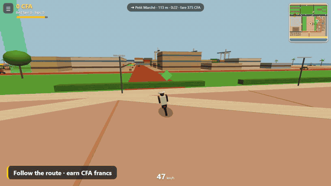
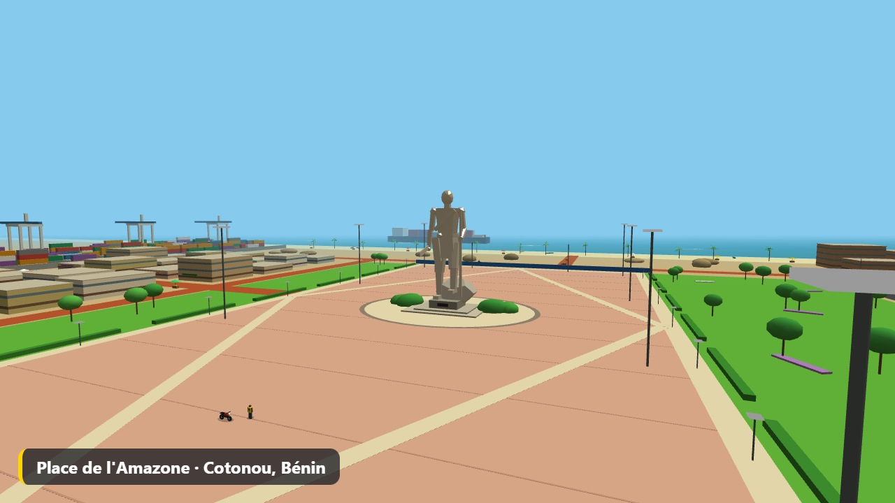
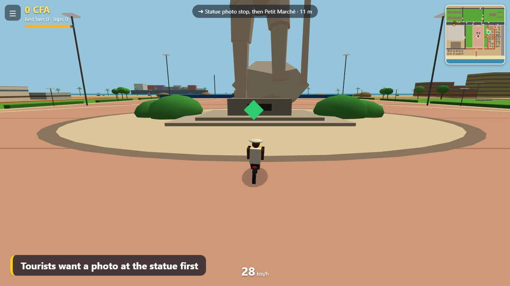
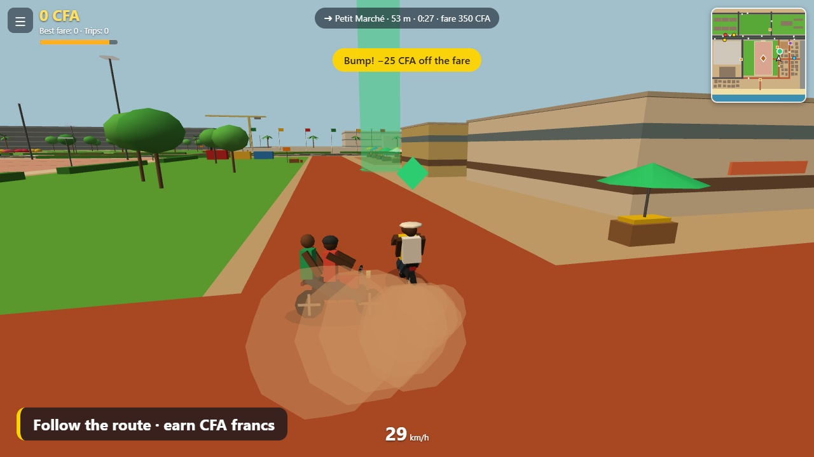
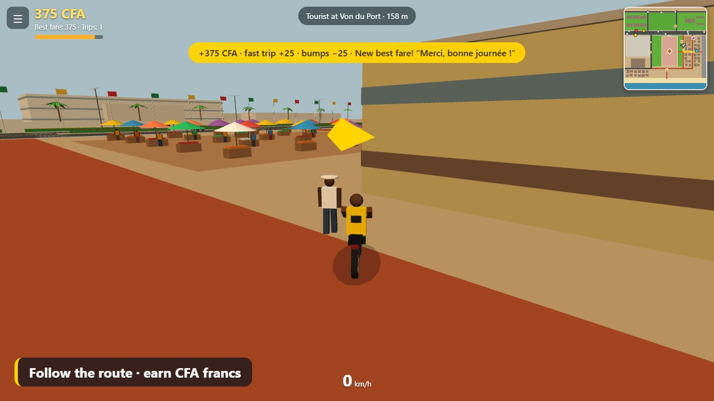
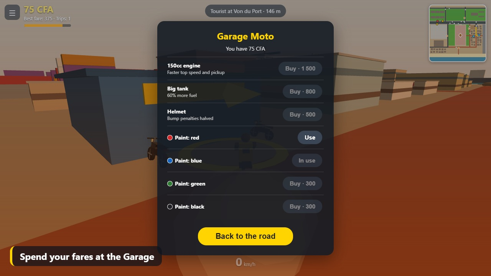
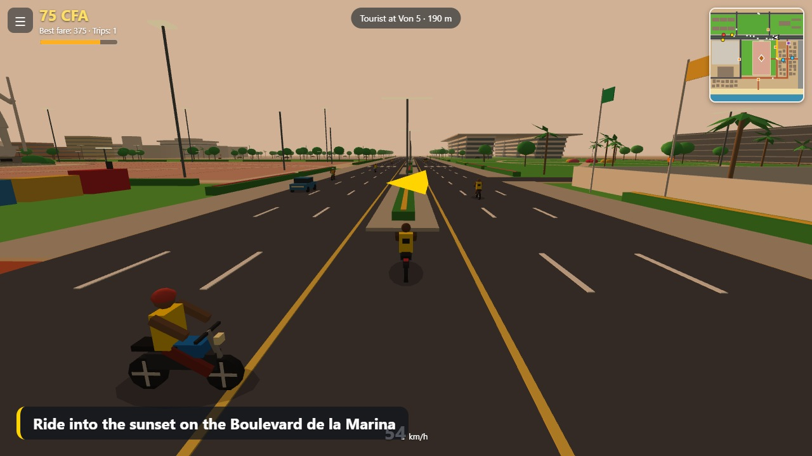

# Kekenon: Cotonou

A small 3D open-world game set around the **Place de l'Amazone** in Cotonou, Bénin.
You are a *Kekenon* — a moto-taxi driver in the famous yellow shirt. Pick up waving passengers, follow the route, drop them off and earn CFA francs.

**▶ Play it in your browser:** https://akotch.github.io/kekenon-cotonou/

No install, no account. Works on a laptop or a phone.

## Screenshots

| | |
|---|---|
|  |  |
|  |  |
|  |  |

A 30-second demo video with sound is in [`media/kekenon-demo.mp4`](media/kekenon-demo.mp4) (4K) and [`media/kekenon-demo-1080p.mp4`](media/kekenon-demo-1080p.mp4).

## How to play

| Action | Keyboard / mouse | Phone |
|---|---|---|
| Walk | `W A S D` or arrow keys | Joystick |
| Run | `Shift` | Hold **RUN / BRAKE** |
| Get on / off, or take any moto or car | `E` (stand next to it) | **MOTO** button |
| Throttle, brake, steer | `W` `S` `A` `D` | Joystick |
| Hard brake | `Shift` or `Space` | Hold **RUN / BRAKE** |
| Horn (traffic ahead speeds up) | `H` | 📯 button |
| Mission board | `J` | 📋 button |
| Look around | Drag with the mouse | Drag on the screen |
| Pause, language, volume, graphics quality | `Esc` | ☰ button |

1. Ride up to a waving passenger and stop next to them.
2. Follow the green route on the minimap to the green beam and stop inside it.
3. Fast trips pay a bonus. Bumping into traffic takes a little off the fare.
4. Open the mission board for bigger jobs: the school run, a market delivery, the port rush and a city tour. Completing missions raises your level and unlocks harder ones.
5. Spend your fares at the Garage (purple square on the minimap): engine, helmet, a sport moto, paint, shirts and horns. Hire other zem drivers who earn for you, and fund city projects that change the map.
6. Smooth rides earn star ratings and tips, and there is a daily earnings goal with a bonus.
7. It is an open world: walk up to any moto or car in traffic and press `E` to push the driver off and take it. Motos reach about 250 km/h, and up to 300 with the Garage upgrades.

Passengers come in four kinds: regular, in a hurry (pays more, but on a timer), market traders (pay more, bumps cost more) and tourists (want a photo stop at the statue first).

The game is available in English and French, has a day-to-night cycle, and guides you through your first trip. Progress is saved in your browser.

## The setting

The map follows the real layout around the Esplanade des Amazones: the statue and its salmon-pink plaza, the Boulevard de la Marina, the Palais des Congrès, the Jardin de l'Amazone, the Cité ministérielle, the Présidence and the Port of Cotonou. It is a stylised low-poly version, not a survey: some distances are compressed, the ocean is closer than in reality, and the market quarter is invented for gameplay.

## Run it locally

Download `index.html` and `three.min.js` into the same folder and open `index.html` in a browser. If `three.min.js` is missing, the game falls back to loading Three.js from a CDN.

## How it is made

- One `index.html` with all the game code inline, plus the Three.js library file — no build step.
- [Three.js](https://threejs.org/) r128 for rendering; everything is basic low-poly geometry with flat colours.
- No external models, textures or audio files: sound is generated in the browser with the Web Audio API.
- Built with Claude Fable 5.2.
